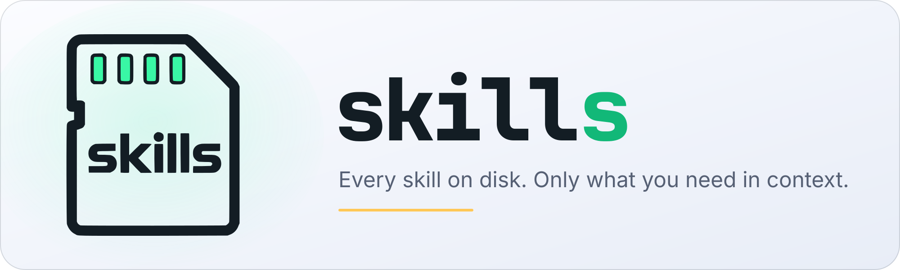

<p align="center">
  
</p>

<p align="center">
  <a href="CHANGELOG.md"></a>
  <a href="LICENSE"></a>
  
  
  <a href="https://github.com/CLOUDWERX-DEV/skills-cli/actions/workflows/ci.yml"></a>
</p>

<p align="center"><b>Digital Food for the Analog Soul</b><br>by <a href="https://cloudwerxlab.com">CLOUDWERX LAB</a></p>

---

`skills` keeps your whole library of agent skills on disk and loads only the ones a task needs, when it needs them. Search takes a few milliseconds. Your agent's startup context stays tiny instead of carrying a catalog of every skill you own.

It's one small Rust binary that reads the standard skill format (a folder with a `SKILL.md`, optional `references/`, `scripts/` and `assets/`), so everything you already have keeps working.

## Why it exists

Skills are great, but the usual way of using them doesn't scale. Put a hundred of them where your agent looks and every single conversation starts by paying for the name and description of all hundred, whether you need them or not. The agent also gets worse at picking the right one when there are that many to choose from, and one careless read of a big skill can drop a couple hundred thousand tokens of docs into the context at once.

So I flipped it around. The library lives on disk. The agent gets one tiny instruction (`skills skill` prints it), and from then on it searches, loads and fetches only what it needs:

```sh
skills search "pdf merge"       # find the skill
skills load pdf-tools           # read its instructions
skills ref get pdf-tools merge  # pull one reference page, not the whole folder
skills run pdf-tools split.py in.pdf   # run a bundled script, only the output comes back
```

My own library is 130 skills in 3,377 files, about 14.8 million tokens. The instructions alone are around 400 thousand. Listing all of them takes 4 ms, and the agent only ever sees what it asked for.

## What you get

- **Fast.** Native Rust, no runtime, about 4 ms to list a library of 130 skills.
- **Progressive loading.** Search, then load, then fetch one reference or run one script. Each step costs only what it returns.
- **Guarded.** Loading a whole reference folder is capped by a token limit unless you say `--force`, so a slip can't flood the context.
- **A real manager.** `new` scaffolds a valid skill, `install` takes skills from a git repo or a folder, `validate` checks them against the format (including every link), `remove` asks first.
- **Slash commands on demand.** `pin` links a skill into an agent's own folder so it shows up as a slash command, `unpin` takes it away, `doctor` repairs what breaks.
- **Self-teaching.** `skills skill` prints a guide built into the binary, so an agent can learn the whole tool with one command.
- **Clean output.** Colors only when it's a terminal, so piping into a context window stays clean.
- **Shell completions** for fish, bash and zsh that know your skill names.

## Install

You need Rust 1.85 or newer to build it, or just grab a binary.

```sh
cargo install --git https://github.com/CLOUDWERX-DEV/skills-cli
```

Or download a binary from the [releases page](https://github.com/CLOUDWERX-DEV/skills-cli/releases), put `skills` on your `PATH`, and you're done. There's a [PKGBUILD](packaging/PKGBUILD) for Arch too.

Then point it at your skills (it already looks in `~/.agents/skills`, `~/.claude/skills`, `~/.codex/skills` and `~/.gemini/antigravity-cli/skills`):

```sh
skills config add ~/my-skills
skills list
```

## Teach your agent to use it

Add this to your agent's instructions (its system prompt, rules file, whatever it reads at startup). It's the only thing that has to be in context:

```markdown
### Skills

You have the `skills` CLI. Keep context lean by loading skills on demand instead of relying on a preloaded catalog.
1. Run `skills skill` once to read the full guide.
2. For a task in a specific domain, run `skills search <words>`.
3. Load what you need with `skills load <skill...>`. Never guess an API a skill documents.
4. Don't dump reference folders. Use `skills ref list|search|get <skill> ...`.
5. Run bundled scripts with `skills run <skill> <script> [args]`.
```

The same guide is a proper skill in [`skills/skills-cli`](skills/skills-cli/SKILL.md), so you can also install it where your agent reads skills:

```sh
skills install CLOUDWERX-DEV/skills-cli --skill skills-cli
```

## Use it

```sh
skills list                        # cards with descriptions and token weights
skills list --table                # one line each
skills search containers           # ranked search
skills load pdf-tools docx --deps  # instructions, plus what they depend on
skills info pdf-tools              # structure and token weight
skills files pdf-tools             # every file, with size and tokens
skills which pdf-tools --ref merge # a path, for scripts
skills stats                       # the whole library
```

### References and scripts

```sh
skills ref list pdf-tools                  # what's there
skills ref search pdf-tools "merge pages"  # search inside
skills ref get pdf-tools merging           # fuzzy names work
skills ref all pdf-tools                   # everything, guarded by a 30,000 token limit
skills run pdf-tools split.py in.pdf       # python, bash, fish, node or a binary
```

### Make, install and remove skills

```sh
skills new pdf-tools --description "Work with PDF files. Use when a task involves a PDF."
skills install owner/repo                      # from GitHub
skills install https://example.com/x.git --skill pdf-tools
skills install ./some-folder --force
skills remove pdf-tools            # shows what it would do
skills remove pdf-tools --yes
skills validate                    # the whole library, links included
```

### Slash commands

```sh
skills pin pdf-tools --agents claude,codex   # shows up as /pdf-tools
skills pinned
skills unpin --all                           # back to lean context
skills doctor --fix                          # repair dead links and permissions
```

Supported agents for pinning: `claude`, `codex`, `agy`, `agents`, `opencode`, `pi` and `hermes`.

### Completions

```sh
skills completions install
```

## Configuration

Where it looks, in order: `-d DIR` flags, then `$SKILLS_PATH` (colon separated), then `./.agents/skills` and `./.claude/skills` in the current folder, then the config file, then the defaults above. `skills config show` prints what it found.

The config file is `~/.config/skills-cli/config.toml`:

```toml
skills_dirs = ["~/my-skills", "~/.agents/skills", "~/.claude/skills"]
max_ref_tokens = 30000
```

More in [docs/skill-format.md](docs/skill-format.md).

## Things to know

- **Scripts run as you.** `skills run` executes a script from a skill with your permissions, the same as running it yourself. Read a skill's scripts before you install it from somewhere you don't trust. See [SECURITY.md](SECURITY.md).
- **Token counts are estimates.** They're a quick approximation (about four characters a token), good for comparing sizes, not for billing.
- **It never deletes through a link.** `remove` and `unpin` remove a link, never the folder it points at.

## Develop

```sh
cargo test
cargo clippy --all-targets
```

The tests build a throwaway library and home folder, so they never touch your real skills. [CONTRIBUTING.md](CONTRIBUTING.md) has the rest.

## Support

If it's useful to you, you can [buy me a coffee](https://buymeacoffee.com/cloudwerxl3). More from us at [cloudwerxlab.com](https://cloudwerxlab.com) and [github.com/CLOUDWERX-DEV](https://github.com/CLOUDWERX-DEV).

MIT licensed. See [LICENSE](LICENSE).
